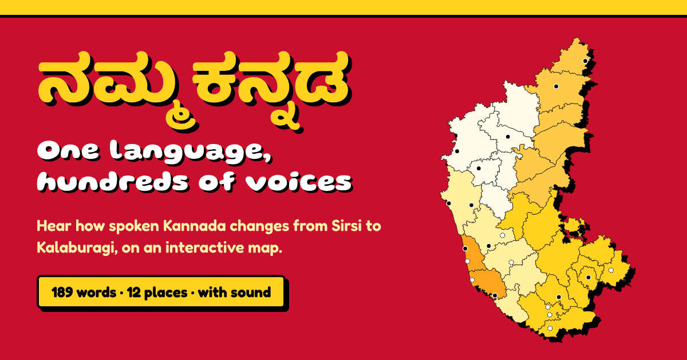

# Namma Kannada (ನಮ್ಮ ಕನ್ನಡ)

**One language, hundreds of voices.** An interactive map of how spoken Kannada changes across Karnataka: regional words, phrases, sounds and sayings, each with its meaning, the standard Kannada form, a pronunciation guide, a voice clip, a cultural note and a link to its source.

**Live site:** https://nammakannada-ak.vercel.app

Built for the Kannada Digital Innovation Hackathon 2026, problem statement 4: *Namma Kannada – Regional Language Explorer*.



## Why

Information about Kannada dialects exists, but it is scattered across dictionaries, Wikipedia, research papers, blogs and Instagram pages. Namma Kannada brings it onto one map, cites every word, lets you hear it, and lets speakers add words from their own town.

## What's inside

| | |
|---|---|
| Words and phrases | 482, every one linked to its source |
| Places | 21 on the map, across 5 cultural regions (every place has words; all but Sullia have at least 20) |
| Voice | AI voice clips for the dialect and standard forms of 189 entries (406 clips); the 293 dictionary words added since are waiting for theirs |
| Comparisons | 39 sets showing the same idea across regions |

Regions covered include Havyaka Kannada (Sirsi), Kundagannada (Kundapura), Arebhashe (Sullia), Halakki (Ankola), Malenadu (Thirthahalli), Dharwad, Bagalkote, Belagavi, Kalaburagi, Bidar, Bengaluru and Mandya.

## Features

- **Ajji's words (ಅಜ್ಜಿ ಮಾತು): record an elder's real Kannada.** Hand your phone to a grandparent. They see a big picture (rain, a door, a snake, two apples) and one generic question, *ಇದಕ್ಕೆ ನಿಮ್ಮೂರಲ್ಲಿ ಏನಂತಾರೆ?*, never the word itself. Written prompts pull people towards textbook Kannada; pictures don't, which is how field linguists elicit dialect. Afterwards you play the answers back, type what was said, see how other regions say the same thing, and share or download a zip of the recordings with an `answers.json` (town, age band, consent, meaning, what was said). Recordings never leave the phone unless you share them.
- **Explore the map.** Tap a region or a place. Each place has an introduction, filters (words, phrases, proverbs, sound changes, grammar, borrowed words) and next/previous navigation.
- **Word cards.** Dialect form in Kannada script, transliteration, a "say it" respelling, English meaning, standard Kannada, a cultural note, the source and whether a speaker has checked it.
- **Checked against a printed dictionary.** 35 everyday Malenadu words (leech, evening, door, have you eaten? …) come from the *Malenada Nudikosha*, each read off the page image and cited by page. 15 of the 16 earlier Malenadu words are also matched to the *Malenada Nudikosha* (Karnataka Folklore University, 2014). Each card shows the page, the headword and gloss as printed, and says plainly where the book differs from the card (for example ಮ್ಯಾಣೆ: the dictionary says throat, not neck). ಹೆಪ್ರ "fool" is not in it.
- **District words from the Kannada Janapada Nighantu.** 233 folk words tagged by district in the Karnataka Folklore University's dictionary on [Padakanaja](https://padakanaja.karnataka.gov.in/dictionary), the Government of Karnataka's portal, bring every place except Sullia to at least 20 words: Mysuru, Nanjangud, Gundlupet (Chamarajanagar district), Mandya, Bengaluru, Kolar, Chikkamagaluru, Shivamogga, Udupi, Mangaluru (Dakshina Kannada), Belagavi, Kalaburagi and Bidar. The dictionary as published on Padakanaja has 7,714 entries, all beginning with a vowel (ಅ to ಔ), so every word from it starts with a vowel too. Each card cites the entry number and district.
- **Hear it.** One tap plays the word. Order of preference: a speaker's own recording, then the Sarvam AI Bulbul voice, then the Alar voice corpus, then the browser's Kannada voice.
- **How to say it.** A pronunciation guide for English readers (vowels, curled-tongue sounds, doubled letters) and the typical sound changes of each region, with playable examples.
- **Compare.** The same phrase across regions side by side, next to standard Kannada.
- **Guess the region.** An 8-word quiz that marks the answer on the map. Works with the keyboard (1–4, Enter).
- **Search** in Kannada script, English or transliteration.
- **Add a word, for everyone.** Visitors add a word from their town, with checks on every field and an optional 8-second voice clip. Once they tick "show my word on the map", it appears straight away for every visitor, marked "added by a visitor · not yet checked". Ajji's words can put a whole session on the map the same way. If the server can't be reached, the word is kept on the visitor's device instead.
- **Sensitive content, handled with care.** Entries about caste, community or violence, and insults, are kept as part of the language record but labelled; the strongest are hidden until you tap to show them, and none appear in the quiz.
- **ಕನ್ನಡ / English in one tap.** The button in the header switches the whole site, including place introductions, word meanings, notes, Privacy and Terms, between Kannada and English, and remembers the choice. Interface text lives in `js/i18n-kn.js`; translations of the word data live in `data/kn.json`.
- **Works on phones.** Mobile menu, a sticky "Add a word" button, and layouts tested from 360px wide to desktop.

## How the sound works

Clips in `audio/ai/` were generated once with [Sarvam AI's Bulbul](https://www.sarvam.ai/text-to-speech) text-to-speech (`scripts/generate-voice.py`) and are served as plain MP3 files. Visitors never call any API, and no key is in the site. A computer voice reads the spelling in a standard accent, so it gives the shape of a word rather than its local tune. The **Record words** page (`#/record`) lets a native speaker record real clips, which then take priority.

To regenerate or add voices, put your key in `.env` (never committed) and run:

```bash
python scripts/generate-voice.py            # all entries without a clip
python scripts/generate-voice.py --limit 2  # try a couple first
```

## Run it locally

Plain HTML, CSS and JavaScript, with no build step and no dependencies. The site loads `data/dialects.json`, so it needs a local server; double-clicking `index.html` will not work.

```bash
npx serve .
# or
python -m http.server 8000
```

## Deploy

Deployed on **Vercel**: import the GitHub repo, no settings needed. `vercel.json` adds the security headers and caching, and `.vercelignore` keeps `.env`, scripts and notes out of the deploy. Vercel also serves `404.html` for unknown addresses.

Other static hosts can serve the site, but the security headers, the 404 page and the root-relative icon paths assume Vercel at the domain root.

## Visitor words: setup

Words visitors add are stored in Upstash Redis through two small Vercel functions (`api/words.js`, `api/audio.js`), with no extra packages. To switch it on:

1. In Vercel, open the project, go to **Storage**, create an **Upstash for Redis** database (the free plan is enough) and connect it to this project. This adds `KV_REST_API_URL` and `KV_REST_API_TOKEN`.
2. In **Settings → Environment Variables**, add `ADMIN_KEY` with a long random value only you know.
3. Redeploy. Until the database is connected, the API answers "not configured" and the site falls back to saving words on the visitor's device.

Safeguards: a consent tick, length limits, Kannada script required, links and a short list of abusive words refused, at most 30 words per visitor per hour and 2,000 a day overall, and recordings capped at 400 KB. IP addresses are not stored; a salted hash is kept for an hour for the rate limit. Remove anything at `/#/admin` with your `ADMIN_KEY`.

## Add or fix words

Everything lives in `data/dialects.json`.

```json
{
  "id": "sir-01",
  "place": "sirsi",
  "type": "word",
  "english": "why",
  "standard": { "kn": "ಯಾಕೆ", "tr": "yaake" },
  "dialect": { "kn": "ಎಂತಕೆ", "tr": "entakke" },
  "note": "Optional cultural note",
  "source": "havyaka",
  "verified": false,
  "voice": { "dialect": "audio/ai/sir-01-dialect.mp3", "standard": "audio/ai/sir-01-standard.mp3" }
}
```

- `place` must match a place `id`; `source` must be a key in `sources`.
- `type` is one of `word`, `phrase`, `grammar`, `sound`, `loanword`.
- Set `verified` to `true` once a native speaker has confirmed the entry.
- Optional `sensitive: { "kind": "caste" | "community" | "violence" | "vulgar" | "insult", "why": "…" }` labels an entry; add `"level": "label"` to label it without hiding it.
- Add a group to `compare_sets` to show entries side by side in Compare.

## Project structure

```
index.html            page shell, SEO and link-preview tags
404.html              page for unknown addresses
css/                  styles and self-hosted fonts
js/app.js             startup, routing, page titles, mobile menu
js/views.js           the pages (map panel, place, compare, guide, quiz, add, privacy, terms…)
js/map.js             SVG map and pins (js/map-data.js is generated)
js/store.js           data loading, search, words saved on this device
js/speech.js          sound playback
js/pronounce.js       Kannada → "say it" respelling
js/recorder.js        the Record words page
js/ajji.js            Ajji's words: picture-prompt recording for elders
js/zip.js             tiny zip writer for downloading a session
js/ui.js              loading, empty states, messages
js/config.js          Google Form link, contact details, quiz length
data/dialects.json    the dataset
audio/                voice clips
scripts/              voice generation and map build tools (not deployed)
```

## Privacy and security

No accounts, no cookies, no third-party requests: fonts, sound and data are all served from the site itself. Words visitors add stay in their own browser. Visits are counted with cookie-free Vercel Web Analytics. The site sends a strict Content-Security-Policy, HSTS and the other standard security headers. See the Privacy and Terms pages on the site.

## Limitations and next steps

- Most entries come from published or online sources and are marked "Not yet checked by a speaker". A dictionary match is shown separately and does not count as a speaker check. The next step is review by native speakers from each region.
- Dictionary words are tagged by district, not town, so the pin stands for its district: Mysuru and Nanjangud share Mysuru-district words, Gundlupet has Chamarajanagar's, Mangaluru has Dakshina Kannada's. Udupi's entries are mostly fish names, because that is what the dictionary lists for Udupi.
- B R Hills shows Solega, a language of its own closely related to Kannada, with 25 words from Aung Si's *Solega-English Dictionary* (2020), cited by page. It is labelled as a neighbouring language, not a Kannada dialect.
- Sullia (Arebhashe) has 14 words. Dakshina Kannada entries in the dictionary are not Arebhashe, so they were not added there; Arebhashe needs its own source or recordings from speakers.
- Voices are AI-generated in a standard accent; real recordings from local speakers would carry the true regional tune.
- Contributions are saved on the visitor's device; a moderated review queue would let them reach everyone.

## Data and credits

Every entry links to its source; the Sources page in the app lists them all, including the Instagram pages [@aarva_karnaata](https://www.instagram.com/aarva_karnaata/) and [@kannada.gothilla](https://www.instagram.com/kannada.gothilla/), Wikipedia, CIIL, Prajavani, Deccan Herald and others.

- Dictionary check: *Malenada Nudikosha*, ed. Venakshi S. D., Karnataka Folklore University, Gotagodi, 2014, read on [Bharatavani](https://bharatavani.in/). The book is all rights reserved, so only page numbers and short headword–gloss citations are in this repo; the book itself is not.

- Map boundaries: [india-maps-data](https://github.com/udit-001/india-maps-data) (2011 census districts). Regions are approximate cultural zones, not official divisions.
- Voices: [Sarvam AI Bulbul](https://www.sarvam.ai/text-to-speech) and the [Alar voice corpus](https://github.com/Aditya-ds-1806/Alar-voice-corpus) (GPL-2.0).
- Fonts: Gluten, Fredoka and Baloo Tamma 2, under the SIL Open Font License.

## Licence and contact

Code: [MIT](LICENSE). Dataset (`data/dialects.json`): [CC BY-SA 4.0](https://creativecommons.org/licenses/by-sa/4.0/). Quoted examples, Alar clips and fonts keep their own licences.

Made by Akshobya A S · asakshobya@gmail.com
